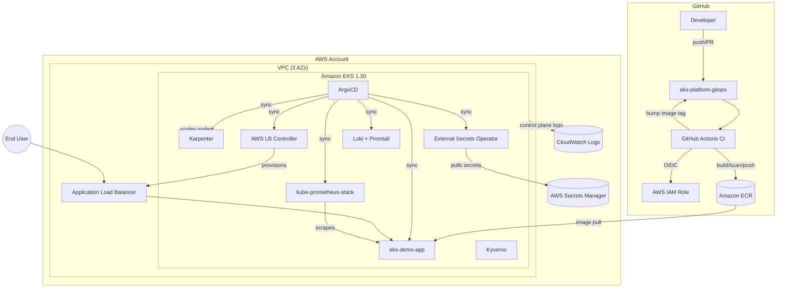

# eks-platform-gitops

[](.github/workflows/ci.yaml)
[](terraform/)
[](LICENSE)
[](terraform/modules/eks)
[](argocd/)

> A production-grade, end-to-end Amazon EKS platform built with Terraform, GitOps (ArgoCD), Karpenter autoscaling, full observability (Prometheus/Grafana/Loki), policy-as-code (Kyverno/OPA), and a GitHub Actions CI/CD pipeline — demonstrated with a sample FastAPI microservice.

## Summary

`eks-platform-gitops` provisions a secure, autoscaling Amazon EKS cluster from scratch using modular Terraform, bootstraps ArgoCD with an app-of-apps pattern, and deploys a Python FastAPI microservice through a full CI/CD pipeline that builds, scans, and promotes container images via GitOps. The platform includes cluster autoscaling with Karpenter, observability with the kube-prometheus-stack and Loki, secrets management via External Secrets Operator + AWS Secrets Manager, and policy enforcement with Kyverno and OPA/Conftest. It is designed to be **fully destroyable in one command** to avoid ongoing AWS charges, and uses **OIDC federation** for GitHub Actions → AWS (no long-lived credentials).

## Architecture



## Features

- **Terraform-first infrastructure**: modular VPC, EKS, IAM/IRSA, ECR, Karpenter, and add-ons modules, with separate `dev` and `prod` environments and remote state.
- **GitOps with ArgoCD**: app-of-apps pattern, automated sync with prune + self-heal, retry with backoff.
- **Autoscaling with Karpenter**: spot + on-demand NodePools, AL2023 `EC2NodeClass`, disruption budgets.
- **Observability**: kube-prometheus-stack (Prometheus, Grafana, Alertmanager) + Loki/Promtail for logs, `ServiceMonitor` wired to the sample app.
- **Security**: IRSA everywhere (no static AWS keys in pods), External Secrets Operator backed by AWS Secrets Manager, NetworkPolicies (default-deny), Kyverno + OPA/Conftest policy-as-code, Trivy/Checkov/tfsec scanning in CI.
- **CI/CD**: GitHub Actions with OIDC-federated AWS access (zero long-lived keys), lint → test → build → scan → push → GitOps tag bump.
- **Sample workload**: a 12-factor FastAPI microservice with health/readiness probes, Prometheus metrics, structured logging, HPA, and an ALB Ingress.
- **One-command bootstrap and teardown** to keep AWS costs under control.

## Tech stack

| Layer            | Tooling                                                              |
|-------------------|----------------------------------------------------------------------|
| IaC               | Terraform >= 1.7, AWS provider ~> 5.60, Kubernetes provider ~> 2.30, Helm provider ~> 2.15 |
| Compute           | Amazon EKS 1.30, Karpenter v0.37+, Managed Node Group (system pool) |
| GitOps            | ArgoCD v2.12+ (app-of-apps)                                          |
| Observability     | kube-prometheus-stack, Grafana, Alertmanager, Loki + Promtail        |
| Security          | External Secrets Operator, AWS Secrets Manager, Kyverno, OPA/Rego, Trivy, Checkov, tfsec |
| Networking        | AWS Load Balancer Controller, VPC endpoints, NetworkPolicies         |
| App               | Python 3.12, FastAPI, Uvicorn, prometheus-fastapi-instrumentator     |
| Packaging         | Docker (multi-stage), Helm 3, Kustomize                              |
| CI/CD             | GitHub Actions (OIDC to AWS), ruff, pytest, ECR                      |

## Repository structure

```text
eks-platform-gitops/
├── .github/workflows/     # CI, Terraform, and nightly security-scan pipelines
├── app/                   # FastAPI microservice + Helm chart
├── terraform/             # modules/ (reusable) + environments/ (dev, prod)
├── kubernetes/            # Kustomize base + overlays (namespace, RBAC, NetworkPolicy)
├── argocd/                # bootstrap manifests + app-of-apps
├── policies/              # Kyverno policies + OPA/Rego for Terraform
├── scripts/                # bootstrap, destroy, port-forward, cost-report
└── docs/                  # architecture, ADRs, runbook
```

## Prerequisites

- An AWS account with admin access (dev/sandbox account recommended)
- Terraform >= 1.7
- AWS CLI v2, configured (`aws configure` or SSO)
- `kubectl` >= 1.30
- `helm` >= 3.14
- `docker`
- An S3 bucket + DynamoDB table for Terraform remote state (see `terraform/environments/*/backend.tf`)
- A GitHub OIDC IAM role for Actions (see `.github/workflows/terraform.yaml`)

## Quick start

```bash
# 1. Provision the VPC, EKS cluster, Karpenter, and all platform add-ons
make bootstrap ENV=dev

# 2. Watch ArgoCD sync the app-of-apps (Prometheus, Loki, the demo app, etc.)
kubectl get applications -n argocd -w

# 3. Access Grafana locally
make port-forward-grafana
```

> First-time bootstrap takes 15-25 minutes (EKS control plane provisioning is the long pole).

## Cost estimate & teardown warning

Running the `dev` environment continuously costs roughly **$150-220/month** (EKS control plane ~$73/mo, NAT Gateway, 2-3 `t3.medium` system nodes, Karpenter spot nodes, ALB, CloudWatch Logs). **This is not a free-tier deployment.**

**Always tear it down when you're done demoing:**

```bash
make destroy ENV=dev
```

`scripts/destroy.sh` removes ArgoCD-managed apps first (so ALBs/LBs are deprovisioned cleanly) before running `terraform destroy`, to avoid orphaned load balancers or EBS volumes that continue to bill.

## Demo

> Add screenshots/GIFs here after your first bootstrap:
> - `docs/img/grafana-dashboard.png` — Grafana dashboards for the demo app
> - `docs/img/argocd-app-of-apps.png` — ArgoCD app-of-apps synced and healthy
> - `docs/img/alb-ingress.png` — the FastAPI demo app served through the ALB

## Security notes

- No IAM user access keys anywhere — GitHub Actions authenticates to AWS via **OIDC**, and every in-cluster controller uses **IRSA**.
- Secrets live only in **AWS Secrets Manager**, synced into the cluster at runtime by **External Secrets Operator**; nothing sensitive is committed to Git (enforced by `gitleaks` in pre-commit and CI).
- Default-deny **NetworkPolicies**, with explicit allows for ALB and monitoring ingress.
- **Kyverno** blocks `:latest` tags, privileged containers, and containers without resource limits at admission time.
- **OPA/Rego** policies gate Terraform plans for public S3 buckets, unencrypted EBS volumes, and missing cost-allocation tags.
- Container images are scanned with **Trivy** on every build; IaC is scanned nightly with **Checkov** and **tfsec**, with SARIF results uploaded to GitHub Security.

## What I learned / trade-offs

- **Karpenter over Cluster Autoscaler**: faster bin-packing, native Spot support, and no need to pre-define ASGs per instance type — see [`docs/decisions.md`](docs/decisions.md).
- **ArgoCD over Flux**: richer UI/CLI for demoing sync status and drift to reviewers, and a more common ask in JDs for this role.
- Chose a **single ArgoCD bootstrap path via `kubectl apply`** (not Helm) so the initial ArgoCD install has no chicken-and-egg dependency on ArgoCD itself managing itself — documented in `docs/decisions.md`.
- Public EKS API endpoint is acceptable for `dev` to simplify demoing; `prod` defaults to private-only, documented as requiring a bastion/SSM or VPN for cluster access.
- Multi-account (e.g., separate `dev`/`prod` AWS accounts via AWS Organizations) is documented as an extension in `docs/decisions.md` rather than implemented, to keep the reference deployment single-account and easy to run.

## License

[MIT](LICENSE)
