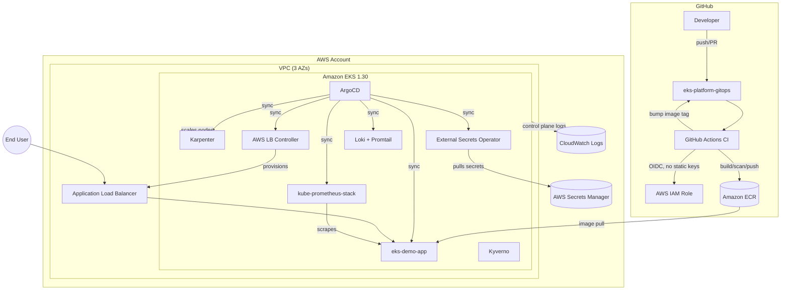

# Architecture

## Overview

`eks-platform-gitops` provisions a single-account Amazon EKS platform with a clean split
between **infrastructure** (Terraform: VPC, EKS control plane, IAM/IRSA, ECR, Karpenter
bootstrap, core add-ons) and **application/platform lifecycle** (ArgoCD GitOps: the sample
app, observability stack, and ongoing add-on reconciliation).

See [architecture.drawio](architecture.drawio) for an editable diagram covering
the VPC subnet layout, IRSA trust relationships, and NodePool topology in more detail.

## Layers

1. **Network (Terraform `modules/vpc`)** — a 3-AZ VPC with public/private subnets,
   NAT Gateway(s), VPC endpoints for ECR/S3/STS/EC2/CloudWatch Logs, and flow logs.
2. **Cluster (Terraform `modules/eks`)** — the EKS control plane, a small managed
   system node group (tainted `CriticalAddonsOnly`), core EKS addons, the OIDC
   provider, and per-controller IRSA roles.
3. **Autoscaling (Terraform `modules/karpenter`)** — the Karpenter controller plus
   two `NodePool`s (`general-purpose`: spot+on-demand, `system`: on-demand only)
   and a shared `EC2NodeClass`.
4. **Bootstrap add-ons (Terraform `modules/addons`)** — AWS Load Balancer
   Controller, Metrics Server, External Secrets Operator, kube-prometheus-stack,
   Loki/Promtail, and Kyverno, installed once via Terraform/Helm to get the
   cluster to a minimally viable state.
5. **GitOps (ArgoCD, `argocd/`)** — ArgoCD itself is installed via `kubectl apply`
   (see `docs/decisions.md`), then an app-of-apps takes over **ongoing**
   reconciliation of the same add-ons plus the demo application, so that any
   drift introduced in-cluster self-heals from what's committed to Git.
6. **Workload (`app/`, `kubernetes/`)** — a FastAPI microservice packaged as a
   Helm chart, with Kustomize base/overlays for namespace-level policy
   (NetworkPolicy, RBAC, ExternalSecret).

## Data flow: a request to the demo app

1. A client hits the ALB's public DNS name.
2. The AWS Load Balancer Controller has already provisioned target groups
   pointing at the `eks-demo-app` pods (via the `Ingress` resource).
3. Traffic reaches a pod; `/health` and `/ready` back the ALB health check and
   Kubernetes probes respectively.
4. The `ServiceMonitor` lets Prometheus scrape `/metrics` every 15s; Grafana
   dashboards visualize latency/error rate/saturation.
5. Structured JSON logs go to stdout, picked up by Promtail, and shipped to Loki.

## Data flow: a code change reaching production

1. A developer opens a PR touching `app/**`.
2. `ci.yaml` lints (ruff), tests (pytest), builds the Docker image, and scans it
   with Trivy (blocking on CRITICAL/HIGH CVEs).
3. On merge to `main`, the image is pushed to ECR and `values-dev.yaml`'s image
   tag is bumped by a bot commit back into the repo.
4. ArgoCD detects the Git change and reconciles the `eks-demo-app` Application,
   rolling out the new image with `prune: true, selfHeal: true`.
5. Terraform PRs go through a separate `terraform.yaml` pipeline: `plan` on PR
   (commented back to the PR), manual-approval `apply` on merge to `main`.
